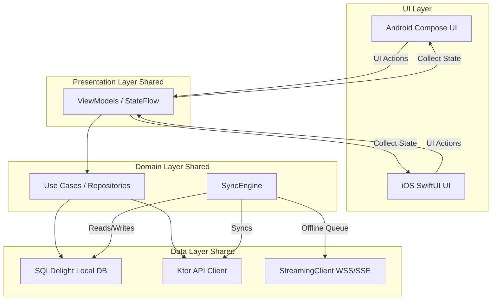

# FieldAI Architecture

## Overview
FieldAI is a production-grade Kotlin Multiplatform (KMP) application designed for professionals in the field. It provides an AI-powered mobile assistant with robust offline support, real-time synchronization, and native platform integrations.

## Architecture

FieldAI follows Clean Architecture and MVVM.

### Architecture Diagram

### Layers

1. **Presentation Layer (UI & ViewModels)**
   - Android: Jetpack Compose
   - iOS: SwiftUI
   - Both platforms use shared ViewModels where possible, exposing `StateFlow` for UI state and `SharedFlow` for single-shot events.
2. **Domain Layer (Use Cases & Models)**
   - Completely platform-agnostic (pure Kotlin).
   - Contains core business logic, entities, and use cases (e.g., `SendMessageUseCase`, `SyncDataUseCase`).
3. **Data Layer (Repositories & Data Sources)**
   - **Local DataSource**: SQLDelight for shared multiplatform database, Room for Android-specific demonstrations, and DataStore for preferences.
   - **Remote DataSource**: Ktor client for REST APIs, Ktor WebSockets for real-time streaming (and SSE fallback).
   - **Sync Engine**: Manages the offline-first queue and synchronizes pending operations using WorkManager on Android.

### Key Components

- **AI Engine**: Interfaces with Groq via a shared `AiProvider`. It leverages Kotlin Flows to handle real-time server-sent events (SSE) for streaming AI responses.
- **Offline-First Synchronization**: The app reads from the local database as the single source of truth. Mutations write to a local pending queue and the local database simultaneously, then a sync engine pushes changes to the backend.
- **Platform Specific Integrations**:
  - **Camera/Scanner**: CameraX (Android) / Native Camera (iOS)
  - **Location**: FusedLocationProvider (Android) / CoreLocation (iOS)
  - **Bluetooth**: Android Bluetooth / CoreBluetooth (iOS)

## Data Flow (Streaming AI Response)

1. User sends a message via UI.
2. ViewModel calls `AiUseCase.sendMessage()`.
3. `AiUseCase` writes the pending message to the Local Database.
4. UI updates instantly from the Database observation.
5. `AiUseCase` calls `AiProvider` which opens a WebSocket/SSE connection to the backend proxy (which talks to Groq).
6. As tokens arrive, they are parsed and emitted via `Flow<AiStreamEvent>`.
7. ViewModel updates the `StateFlow` with the accumulating string.
8. Compose/SwiftUI reactively re-renders the tokens.

## Real-Time & Offline Sync

- **Online**: Real-time events arrive via WebSocket and immediately update the local database.
- **Offline**: Actions are queued in a `PendingOperation` table.
- **Reconnection**: `WorkManager` (Android) / `BGTaskScheduler` (iOS) processes the pending queue with exponential backoff.
